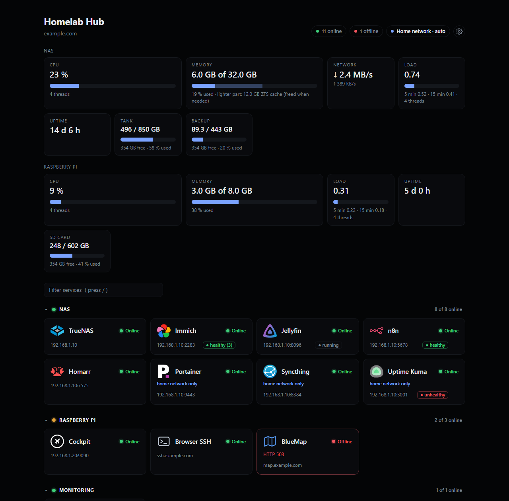

# Homelab Hub

A small self-hosted start page for your homelab: one card per web UI, each with a green/red **Online / Offline** dot.
Docker containers show their health, and the server's stats (CPU, memory, load, network, storage) sit at the top.
Everything is configured in **one YAML file**, which you can also edit on the page itself.



<details>
<summary>Light theme</summary>


</details>

- **Online checks** over HTTP(S) or plain TCP, done by the server, so open tabs cost nothing
- **Container health** through a read-only Docker socket proxy
- **Cards from Docker labels**: label a container and its card appears by itself
- **Stats from several machines**: the same image runs as a small agent on your other servers
- **Home network detection**: at home the cards open the LAN address, away the public one
- **Config editor on the page** (form or plain YAML) with validation; a broken config never takes the page down
- **Icons by name**: `icon: jellyfin` is fetched once from [dashboard-icons](https://github.com/homarr-labs/dashboard-icons) and kept
- **Optional password login**, or put it behind Cloudflare Access, Authelia, Authentik, a VPN …
- Dark and light theme, English and German
- Node.js, one dependency (`yaml`), no build step, no database; images for amd64 and arm64 (Raspberry Pi)

## Quick start (Docker)

Save [compose.yaml](compose.yaml) on your server, then:

```bash
docker compose up -d
```

Open `http://<server>:8080`. The page starts with one example card: open the gear menu (top right) → **Edit YAML** and
add your own services. The config is stored in `./data/services.yaml`.

- **Storage tiles:** add one mount line per disk or pool in `compose.yaml` and one entry under `stats.disks`.
- **TrueNAS:** paste the same file under *Apps → Discover Apps → ⋮ → Install via YAML*; details in [DEPLOY.md](DEPLOY.md).
- **Just looking?** `npm install && npm run demo` shows the page with made-up data on `http://localhost:8099`.

> **Who can open it?** Without a password, anyone who can reach the port can see the page and edit the config. That is
> fine on a home network you trust. For anything else, set `HUB_PASSWORD` (below) or put a login proxy in front.

## Password login (optional)

Set these in `compose.yaml` under `environment:`:

| Variable | Meaning |
|---|---|
| `HUB_PASSWORD` | The password. Unset or empty = no login |
| `HUB_PASSWORD_PROTECTS` | `all` (default): the whole page needs the login. `editor`: everyone sees the page, only the config editor needs it |

The login lasts 30 days per browser; changing the password logs everyone out. Five wrong passwords lock that address
for a minute. Use HTTPS (a reverse proxy) when the hub is reachable from outside your home network: over plain HTTP the
password travels unencrypted.

## Edit the config

In Docker the file is `/config/services.yaml` (`./data/services.yaml` on the host), created on the first start.
[config/services.yaml](config/services.yaml) is a full example with every option.
The hub re-reads the file every check cycle (about 30 s), no restart. A mistake never breaks the page: it keeps the last
working version and shows a red box naming the problem.

**On the page:** gear menu → **Edit YAML**. The *Visual* tab is a form (general settings, hosts, storage tiles, groups
and services with add / remove / reorder / duplicate and an icon picker); the *YAML* tab is the plain text. Problems
are listed while you type, and a config with problems is not saved. Saving applies at once, keeps the comments and
layout of everything you did not touch, and leaves the version before in `services.yaml.bak`.
To switch the editor off, set `CONFIG_EDITOR: "off"`.

```yaml
hosts:
  nas: 192.168.1.10
groups:
  - name: NAS
    services:
      - name: Immich
        icon: immich                          # an icon name from dashboard-icons
        url: https://photos.example.com       # where the card links to
        local: http://{nas}:2283              # where it links to on the home network
        check: http://{nas}:2283              # what decides the dot
        containers: ["*immich*"]              # show container health (optional)
```

| Field | Meaning |
|---|---|
| `url` | Public address the card opens. Optional if `local` is set |
| `local` | Address the card opens on the home network (optional; alone = "home network only") |
| `icon` | Icon name (see below). Missing = default icon |
| `check` | `http://…` / `https://…` (online = any answer below 500), `tcp://host:port` (port accepts connections), or `none` |
| `insecure` | `true` accepts a self-signed certificate on the check (Cockpit, Portainer) |
| `containers` | Patterns (`*` wildcard) matched against container name, compose project or service name |
| `hidden` | `true` keeps the entry but hides it |
| `hosts` | Aliases usable as `{name}` in `url`, `local` and `check` |

**Icons:** write the name of any icon from [dashboard-icons](https://github.com/homarr-labs/dashboard-icons)
(`jellyfin`, `home-assistant`, `pi-hole` …). If the hub doesn't have it yet, it downloads the SVG once into `icons/`
next to the config file and serves it itself from then on. In the editor's icon picker you can also paste a link to any
`.svg` file. Only SVGs without scripts are accepted. `ICON_DOWNLOAD: "off"` stops the hub from fetching icons by itself.

**Container health:** `healthy`, `running` (the image has no healthcheck), `starting`, `unhealthy`, `stopped`,
`no container found` (the pattern matches nothing: look at `/api/containers`, linked in the footer).
A group with `autoContainers: true` gives every card a badge when a container matches the card's name
(`Uptime Kuma` finds `*uptime-kuma*`).

## Cards from Docker labels

Instead of writing a card into the YAML, put labels on the container. The card appears on the next check and goes
away with the container:

```yaml
services:
  grafana:
    image: grafana/grafana
    labels:
      homelab-hub.name: Grafana                      # default: the compose service name
      homelab-hub.url: https://grafana.example.com   # url and/or local is required
      homelab-hub.local: http://{nas}:3000           # {host} shortcuts from the YAML work
      homelab-hub.group: Monitoring                  # default: "Docker"
      homelab-hub.icon: grafana
      homelab-hub.check: http://{nas}:3000           # optional, like `check:` in the YAML
```

Also understood: `homelab-hub.description`, `homelab-hub.insecure: "true"`, `homelab-hub.hide: "true"`.
Label cards join the group of the same name from the YAML (a card with the same name in the YAML wins), show the
health of their container, and need the docker-proxy from `compose.yaml`. A label with a mistake is listed under
`labelErrors` in `/api/containers`. Switch the feature off with `settings.dockerLabels: false`.

## Stats from other machines

The stats tiles at the top show the machine the hub runs on. To add another machine (a Raspberry Pi, a second
server, a VPS), run the same image there in **agent mode**. An agent has no page and no config; it only answers the
hub with that machine's numbers.

**On the other machine:** save [compose.agent.yaml](compose.agent.yaml) as `compose.yaml` and run `docker compose up -d`
(or without Docker: `HUB_MODE=agent PORT=8081 node src/server.js`).

**On the hub**, in the YAML (or gear menu → Edit YAML → *Server stats* → *Other machines*):

```yaml
stats:
  name: NAS                             # caption of the hub's own tiles
  machines:
    - name: Raspberry Pi
      url: http://{pi}:8081             # the agent's address; {host} shortcuts work
      token: a-long-random-text         # only if the agent has AGENT_TOKEN set
      network: [eth0]                   # optional: cards for the network tile
      disks:                            # optional: storage tiles, paths as the AGENT sees them
        - { name: SD card, path: /pools/root, size: 29G }
```

Each machine gets its own row of tiles under its name. One that does not answer shows why (refused, timed out, wrong
token) and never holds up the others. The hub asks every `statsIntervalSeconds`.

| Agent variable | Meaning |
|---|---|
| `HUB_MODE=agent` | Start as an agent instead of as the hub |
| `AGENT_TOKEN` | Optional shared secret. Without it, anyone who can reach the port can read the numbers |
| `PORT`, `PROC_PATH`, `SYS_PATH` | As for the hub |

Things to know: the agent only reports numbers and free space of the paths the hub asks for, nothing else. The token
is stored in the hub's YAML, so everyone who may open the config editor can read it. Agent addresses and tokens are
never sent to the page. Use the token, and HTTPS or a VPN, when the agent is reachable from outside your network.

## Home network: local addresses

Give a service a `local:` address and its card opens that address when you are on the home network.
A service with only `local:` is shown greyed out as "home network only" when you are away.

The hub decides per visit, on the server:

1. Opened **directly on the LAN** (`http://192.168.1.10:8080`) = home.
2. Opened **through a proxy or tunnel** = home when your address is a private one (a proxy on your LAN), or when your
   public IP is the server's public IP or one of `settings.home.publicIps`.
3. Otherwise away. The button at the top (**Home network / Away · auto**) switches Auto → Home → Away and remembers
   the choice in that browser.

For rule 2 the hub must learn the visitor's address from the proxy. Cloudflare's header is understood out of the box;
for another proxy (Caddy, Traefik, Nginx Proxy Manager …) name its header:

```yaml
settings:
  home:
    clientIpHeader: x-forwarded-for     # or x-real-ip
```

The setting only decides which links the cards show. It is not a security feature.

## Behind a login proxy

Services behind a login proxy answer with the login page even when the service itself is dead, so checking their public
address says nothing. The hub shows such a check as a grey **Unknown** dot instead of a false green one: for Cloudflare
Access automatically, for your own login page when you list its host name:

```yaml
settings:
  loginHosts: [auth.example.com]        # Authelia, Authentik, Keycloak ...
```

The fix is always the same: point `check:` at the service itself (server IP and port).

## Appearance and language

Gear menu → *Appearance*: theme (automatic / dark / light) and language (automatic / English / Deutsch), remembered per
browser. `settings.language: de` in the YAML sets the default for everyone who has not chosen.
Texts that come from the server (config problems, some check details) are English.
Another language is one block in [public/i18n.js](public/i18n.js); see [CONTRIBUTING.md](CONTRIBUTING.md).

## Run it without Docker

```bash
npm install
npm test                      # no network needed
npm run demo                  # http://localhost:8099 with made-up services, containers and stats
npm run local                 # http://localhost:1212 with config/local.yaml (a copy of the example, made on the first run)
```

`npm run local` runs real checks against the addresses in `config/local.yaml` (git-ignored, so your real addresses can
go there). On Windows and macOS there is no `/proc`, so the stats tiles show this computer's numbers, and without
Docker there are no container badges.

Environment variables:

| Variable | Default | Meaning |
|---|---|---|
| `PORT` | `8080` | Port to listen on |
| `CONFIG_PATH` | `config/services.yaml` (`/config/services.yaml` in Docker) | The config file |
| `DEFAULT_CONFIG_PATH` | | Copied to `CONFIG_PATH` when that doesn't exist yet |
| `DOCKER_HOST` | empty | Docker API (`http://docker-proxy:2375`); empty = no container health, no label cards |
| `PROC_PATH`, `SYS_PATH` | `/proc`, `/sys` | Where the host's stats are mounted |
| `HUB_PASSWORD`, `HUB_PASSWORD_PROTECTS` | | Login, see above |
| `CONFIG_EDITOR` | on | `off` removes the editor |
| `ICON_DOWNLOAD` | on | `off` never fetches icons |
| `PUID`, `PGID` | `1000` | Docker only: the user the hub runs as |
| `HUB_MODE`, `AGENT_TOKEN` | | Agent mode, see "Stats from other machines" |

## Open it like an app on Windows (taskbar)

```bash
powershell -ExecutionPolicy Bypass -File scripts\windows-shortcut.ps1 -Url https://hub.example.com/
```

Creates a **Homelab Hub** shortcut (Start menu and desktop) that opens the hub in its own Chrome window with the hub's
icon. `-ProfileEmail you@example.com` or `-ProfileDir "Profile 1"` picks the Chrome profile. Pin it to the taskbar by
hand: right-click the shortcut → **Pin to taskbar**.

## How it works

`src/monitor.js` checks everything on a timer and keeps the result in memory; the page (`public/`) only reads
`/api/status`. Container health and labels come from Docker through a read-only socket proxy
(`tecnativa/docker-socket-proxy` allows only "list containers"). Host stats are read from the host's `/proc` and `/sys`.

- **Network** tile: download / upload speed over the physical network cards. Pick cards with `stats.network: [eno1]`.
- **Groups open and close:** click a group's name. A group whose services are all offline starts closed.
- **Pins:** the pin button on a card puts it into a **Pinned** section at the top, remembered per browser.
- **Storage:** one tile per entry in `stats.disks`, each pointing at a folder mounted read-only into the container.
  With `size:` (e.g. `size: 3.6T`) the tile shows used / total and a bar: a container can't read a ZFS pool's total, so
  you set it once (`zfs list -Hp -o name,used,avail -d 0`, size = used + avail).
- **Memory** "used" leaves out the ZFS cache (ARC), which is shown separately.
- **Two timers** decide how fresh the data is: stats every `statsIntervalSeconds` (default 5 s), services and
  containers every `checkIntervalSeconds` (default 30 s).

| Path | What |
|---|---|
| `config/services.yaml`, `config/starter.yaml` | Full example config; the small one a new install starts with |
| `src/` | `server.js` (HTTP), `monitor.js` (timer + snapshot), `config.js`, `checks.js`, `docker.js`, `stats.js`, `network.js` (home detection), `auth.js` (login), `agent.js` (stats from other machines), `icons.js`, `editor.js` (config editor API) |
| `public/` | The page: `index.html`, `app.js`, `style.css`, `i18n.js` (translations), `theme.js`, the login page, the config editor, `icons/` |
| `test/` | `node --test` suites, with fake servers and `/proc` fixtures |
| `Dockerfile`, `docker-entrypoint.sh`, `compose.yaml`, `compose.agent.yaml` | Docker: the hub, and the agent for other machines |
| `compose.truenas.yaml`, `scripts/`, `DEPLOY.md` | Building on a TrueNAS box, helper scripts |

## Contributing, credits, license

Bug reports and pull requests are welcome: see [CONTRIBUTING.md](CONTRIBUTING.md). Code: [MIT](LICENSE).

Most icons in `public/icons/` come from [dashboard-icons](https://github.com/homarr-labs/dashboard-icons) (Apache-2.0).
The logos are trademarks of their respective owners and are used only to identify the services.
`default`, `todo-sync`, `light`, `alarm`, `bluemap` and `terminal` were drawn for this project.
