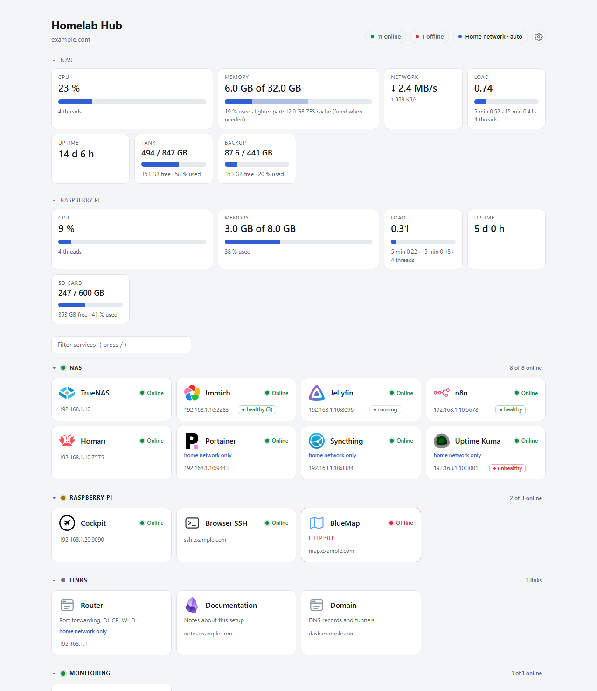

# Homelab Hub

A small self-hosted start page for your homelab: one card per web UI, each with a green/red **Online / Offline** dot.
Docker containers show their health, and the server's stats (CPU, memory, load, network, storage) sit at the top.
Everything is configured in **one YAML file**, which you can also edit on the page itself.


<details>
<summary>Light theme</summary>



</details>

- **Online checks** over HTTP(S) or plain TCP, done by the server, so open tabs cost nothing
- **Container health** through a read-only Docker socket proxy, and **cards from Docker labels**
- **Stats from several machines**: the same image runs as a small agent on your other servers
- **Home network detection**: at home the cards open the LAN address, away the public one
- **Everything is edited on the page**: a form with drag and drop, or the YAML with color coding; a broken config never takes the page down
- **Finds your services** in Docker, and **imports** from Homepage, Dashy and Homarr
- **Icons by name** from [dashboard-icons](https://github.com/homarr-labs/dashboard-icons)
- **Widgets**: a few values from a service's own API (photos in Immich, streams in Jellyfin …) on its card or on a tile of their own; ready-made for well-known services, or made, tested and shared in the editor
- **Themes**: dark, light, Catppuccin, Nord, Gruvbox, high contrast, and your own, made and shared in the editor
- **Optional password login**, or put it behind Cloudflare Access, Authelia, Authentik, a VPN …
- **Works on a phone** and can be installed as an app; English and German
- Node.js, one dependency (`yaml`), no build step, no database; images for amd64 and arm64 (Raspberry Pi)

## Quick start

Save [compose.yaml](compose.yaml) on your server, then:

```bash
docker compose up -d
```

Open `http://<server>:8080`. A new hub shows three steps: add your services, let it look for what already runs in Docker
on the server, and set a password. After that, the gear menu (top right) → **Edit services and settings** opens the
editor, and the pencil on a card or group opens it right there. The config is kept in a Docker volume, so it survives
updates.

- **TrueNAS:** paste the same file under *Apps → Discover Apps → ⋮ → Install via YAML*; details in [DEPLOY.md](DEPLOY.md).
- **Just looking?** `npm install && npm run demo` shows the page with made-up data on `http://localhost:8099`.

**Update:** `docker compose pull && docker compose up -d`. Your config is kept; the gear menu shows the running
version and tells you when there is a newer one. Versions and what changed: [Releases](https://github.com/simonholzer/Homelab-Hub/releases), [CHANGELOG.md](CHANGELOG.md).

> **Who can open it?** Without a password, anyone who can reach the port can see the page and edit the config. That is
> fine on a home network you trust. For anything else, set a password (gear menu → *Set a password*) or put a login
> proxy in front.

## A card in the YAML

```yaml
hosts:
  nas: 192.168.1.10
groups:
  - name: NAS
    services:
      - name: Immich
        icon: immich                          # an icon name from dashboard-icons
        url: https://photos.example.com       # where the card links to
        local: http://{nas}:2283              # where it links to on the home network
        check: http://{nas}:2283              # what decides the dot
        containers: ["*immich*"]              # show container health (optional)
```

[config/services.yaml](config/services.yaml) is a full example with every option.

## Documentation

| | |
|---|---|
| [Configuration](docs/configuration.md) | The editor, every field of a card, plain links, icons, container health, cards from Docker labels, settings, language |
| [Widgets](docs/widgets.md) | Values from a service's API on its card: making, testing and sharing widgets, `widgets.yaml` |
| [Themes](docs/themes.md) | Picking a theme, making your own in the editor, the colors, sharing and importing themes |
| [Server stats and other machines](docs/machines.md) | Storage and network tiles, agents on other machines, their containers, finding agents |
| [Login, home network and proxies](docs/access.md) | Password login, local addresses at home, reverse proxies, login proxies |
| [Installing, updating and running](docs/install.md) | Versions, phone and app, running without Docker, environment variables, how it works |
| [TrueNAS](DEPLOY.md) | Installing and updating on TrueNAS, building the image there |

## Contributing, credits, license

Bug reports and pull requests are welcome: see [CONTRIBUTING.md](CONTRIBUTING.md). Code: [MIT](LICENSE).

Most icons in `public/icons/` come from [dashboard-icons](https://github.com/homarr-labs/dashboard-icons) (Apache-2.0).
The logos are trademarks of their respective owners and are used only to identify the services.
`default`, `todo-sync`, `light`, `alarm`, `bluemap` and `terminal` were drawn for this project.
The Catppuccin, Nord and Gruvbox palettes are MIT-licensed; see [docs/themes.md](docs/themes.md).
